# Knightly Relational Database Design Specification (SD2)

This document specifies the complete relational database model for **Knightly**, fulfilling **Project Implementation Requirement SD2** ("Design your relational database").

The database is built on **PostgreSQL 15+** and hosted via **Supabase**, providing relational integrity, atomic transaction triggers, Row-Level Security (RLS), and unified cloud data persistence for Calvin University campus life.

---

## 1. System Identity & Architecture Overview

Knightly coordinates announcements, student organization leadership, campus safety, directory lookups, digital student IDs, and an autonomous campus dining system designed to replace legacy providers (e.g. Transact Campus).

### Key Architectural Invariants
- **Identity & Authentication**: Integrated with Calvin's **Microsoft Entra ID (Azure AD)** and Microsoft Authenticator MFA. Students log in once; secure refresh tokens are stored in hardware-backed storage (`expo-secure-store` on iOS Keychain/Android KeyStore) for silent background re-authentication.
- **Autonomous Dining Services Ledger**: An event-sourced, immutable transaction ledger (`dining_transactions`) tracks all meal swipes, flex meals, guest passes, KnightBucks, and Dining Dollars. A PostgreSQL trigger atomically recalculates student balances with zero race conditions.
- **Time-Windowed Swipe Resets**: Weekly swipe cycles (`date_trunc('week', ...)`) dynamically calculate remaining meal allotments, eliminating fragile midnight cron jobs.
- **Unified Posts & Calendar Ingestion**: Scraped `calvin.edu/events/all` Drupal events and student-authored club flyers are ingested into a unified `posts` table with idempotent unique keys (`external_event_id`).
- **Cryptographic Claim Code Security**: 10-character club claim codes (`XXXX-XXXX-XX`) are stored strictly as salted SHA-256 hashes (`code_hash`), preventing plaintext credential exposure in database dumps.
- **FERPA Compliance & Directory Onboarding**: Faculty/staff directory info is public. Students receive an onboarding prompt on initial login to opt into directory listing (defaulting to email only, with settings toggling).
- **Server-Authoritative Timestamps**: Post creation timestamps (`posted_at` and `created_at_ms`) are strictly generated server-side using database defaults (`DEFAULT NOW()`).

---

## 2. Relational Entity-Relationship Diagram (ERD)

```mermaid
erDiagram
    STUDENTS ||--o{ CLUB_FOLLOWS : follows
    STUDENTS ||--o{ CLUB_MEMBERSHIPS : leads
    STUDENTS ||--o{ SAVED_POSTS : bookmarks
    STUDENTS ||--|| STUDENT_DINING_ACCOUNTS : has
    STUDENTS ||--o{ DINING_TRANSACTIONS : conducts
    STUDENTS ||--o{ POSTS : authors

    CLUBS ||--o{ CLUB_FOLLOWS : "followed by"
    CLUBS ||--o{ CLUB_MEMBERSHIPS : "has officers"
    CLUBS ||--o{ CLUB_CLAIM_CODES : "issued codes"
    CLUBS ||--o{ POSTS : publishes

    MEAL_PLANS ||--o{ STUDENT_DINING_ACCOUNTS : "assigned to"
    DINING_VENUES ||--o{ DINING_HOURS : operates
    DINING_VENUES ||--o{ DINING_STATIONS : features
    DINING_VENUES ||--o{ DINING_TRANSACTIONS : processes
    DINING_STATIONS ||--o{ DINING_MENU_ITEMS : serves

    POSTS ||--o{ SAVED_POSTS : "saved in"

    STUDENTS {
        uuid id PK "Matches auth.users.id (Microsoft Entra ID)"
        string student_id UK "e.g. 2346052 (variable length 6-10 digits, VARCHAR(32))"
        string username UK "e.g. jmd42"
        string email UK "e.g. jmd42@calvin.edu"
        string first_name
        string middle_name
        string last_name
        int class_year
        string standing "Freshman|Sophomore|Junior|Senior"
        string major
        string minor
        string card_number "VARCHAR(32)"
        string barcode "VARCHAR(48): 00000{id}00"
        string residence "Hall & Room"
        string advisor
        string role "student|moderator|admin"
        boolean directory_opt_in "FERPA directory preference"
        boolean directory_prompted "Has seen onboarding popup"
        jsonb directory_visible_fields "{email: true, phone: false, residence: false}"
        timestamptz created_at
        timestamptz updated_at
    }

    CLUBS {
        string id PK "Slug: abstraction, acm, etc."
        string name
        string category "Standard 13 taxonomy"
        string mark "2-letter monogram"
        string tagline
        text description
        string meeting_schedule
        string location
        string contact_email
        string leader_name
        string primary_color "hex"
        string secondary_color "hex"
        string sf_icon
        string md_icon
        string image_url
        boolean is_department
        int follower_count "Internal/admin only; strictly suppressed from clubs & public UI (non-social invariant)"
        timestamptz created_at
    }

    CLUB_CLAIM_CODES {
        uuid id PK
        string club_id FK
        string code_hash UK "Salted SHA-256 of normalized 10-char code"
        string formatted_preview "XXXX-****-**"
        boolean is_redeemed
        uuid redeemed_by_student_id FK
        timestamptz redeemed_at
        timestamptz expires_at
        timestamptz created_at
    }

    CLUB_MEMBERSHIPS {
        uuid id PK
        uuid student_id FK
        string club_id FK
        uuid claim_code_id FK
        timestamptz granted_at
    }

    CLUB_FOLLOWS {
        uuid student_id FK
        string club_id FK
        timestamptz followed_at
    }

    POSTS {
        uuid id PK
        string club_id FK "nullable for scraped/system posts"
        uuid author_student_id FK "Required for club posts (admin accountability); nullable for scraped events"
        string org_name
        string mark
        string headline
        text body
        string category "Standard 13 taxonomy"
        date event_date
        time start_time
        time end_time
        string when_text "Formatted preview string"
        string where_text "Venue location"
        string image_url "Supabase storage CDN link"
        string fallback_banner_svg "Preset banner key"
        boolean campus_wide
        string source "club|calvin_drupal|admin"
        string external_event_id UK "Unique URL or hash for scraped events"
        string status "published|draft|archived"
        timestamptz posted_at "Server authoritative"
        bigint created_at_ms "UTC ms epoch"
    }

    SAVED_POSTS {
        uuid student_id FK
        uuid post_id FK
        timestamptz saved_at
    }

    MEAL_PLANS {
        string id PK "core21, core17, core14, core10, core5, knollcrest60, joust30"
        string name
        string cadence "weekly|semester"
        int swipes_total
        int flex_meals
        int guest_passes
        decimal bundled_knight_bucks
        string week_resets_on
        text description
    }

    STUDENT_DINING_ACCOUNTS {
        uuid student_id PK, FK
        string meal_plan_id FK
        int swipes_used
        int flex_meals_used
        int guest_passes_used
        decimal knight_bucks
        decimal dining_dollars
        string external_transact_id "Sync ID for contract transition"
        timestamptz updated_at
    }

    DINING_VENUES {
        string id PK "commons, knollcrest, uppercrust, peets, johnnys"
        string name
        string location
        text description
        boolean accepts_swipes
    }

    DINING_HOURS {
        uuid id PK
        string venue_id FK
        int day_of_week "0=Sunday..6=Saturday"
        string meal_period "Breakfast, Lunch, Dinner, Late Night"
        int start_minute_after_midnight
        int end_minute_after_midnight
    }

    DINING_STATIONS {
        uuid id PK
        string venue_id FK
        string name "Grill, Homestyle, Pure Eats, Deli"
    }

    DINING_MENU_ITEMS {
        uuid id PK
        uuid station_id FK
        string item_name
        boolean is_vegetarian
        boolean is_vegan
        boolean is_gluten_free
    }

    DINING_TRANSACTIONS {
        uuid id PK
        uuid student_id FK
        string venue_id FK
        string transaction_type "meal_swipe|flex_meal|guest_pass|knight_bucks|dining_dollars"
        decimal amount "1.0 for swipe, dollar value for tender"
        string register_id "Terminal identifier"
        string cashier_id "Staff identifier or self-kiosk"
        string description
        string external_transact_ref "Receipt ID for reconciliation"
        timestamptz created_at
    }

    CAMPUS_SAFETY_ALERTS {
        uuid id PK
        string severity "critical|warning|info"
        string title
        text detail
        string area "All campus, Knollcrest East, etc."
        boolean is_active
        timestamptz created_at
        timestamptz expires_at
    }

    CAMPUS_SAFETY_CONTACTS {
        string id PK "dispatch, emergency, health_services, escort"
        string name
        string detail
        string phone
        boolean urgent
        int sort_order
    }

    DIRECTORY_PEOPLE {
        uuid id PK
        uuid student_id FK "nullable: linked if student"
        string first_name
        string last_name
        string role "Faculty|Staff|Student"
        string title
        string department
        string email UK
        string phone
        string office_location
        string office_hours
        string pronouns
        text interests
        boolean is_public_visible "Computed or FERPA approved"
    }

    AUDIT_LOGS {
        uuid id PK
        uuid actor_id FK
        string action "claim_club|create_post|delete_post|update_role|dining_override"
        string target_type "post|club|student|dining"
        string target_id
        jsonb metadata
        timestamptz created_at
    }
```



---

## 3. Data Dictionary

### 3.1 `students`
| Column | Type | Constraints | Description |
| :--- | :--- | :--- | :--- |
| `id` | UUID | PK, REFERENCES `auth.users(id)` | Maps 1:1 to Microsoft Entra ID authenticated user |
| `student_id` | VARCHAR(32) | NOT NULL, UNIQUE | University student ID (variable length 6-10 digits: e.g. `2346052`) |
| `username` | VARCHAR(64) | NOT NULL, UNIQUE | Calvin network username (e.g. `jmd42`) |
| `email` | VARCHAR(255) | NOT NULL, UNIQUE | Institutional email (`@calvin.edu`) |
| `first_name` | VARCHAR(100) | NOT NULL | Given name |
| `middle_name` | VARCHAR(100) | NULL | Middle name (for formal Knight Card display) |
| `last_name` | VARCHAR(100) | NOT NULL | Surname |
| `class_year` | INT | NOT NULL | Expected graduation year (e.g. `2028`) |
| `standing` | VARCHAR(32) | NOT NULL | `Freshman`, `Sophomore`, `Junior`, `Senior` |
| `major` | VARCHAR(150) | NOT NULL | Primary academic major |
| `minor` | VARCHAR(150) | NULL | Secondary minor |
| `card_number` | VARCHAR(32) | NOT NULL | Card identifier printed on physical Knight Card |
| `barcode` | VARCHAR(14) | GENERATED ALWAYS AS STORED | 14-digit hardware scanner code: `'00000' \|\| student_id \|\| '00'` |
| `residence` | VARCHAR(150) | NULL | Residence hall & room (e.g. `Boer-Bennink Hall, Rm 214`) |
| `advisor` | VARCHAR(150) | NULL | Assigned faculty advisor |
| `role` | VARCHAR(32) | NOT NULL, DEFAULT `'student'` | `student`, `moderator`, `admin` |
| `directory_opt_in` | BOOLEAN | NOT NULL, DEFAULT `FALSE` | FERPA consent: display in student directory |
| `directory_prompted` | BOOLEAN | NOT NULL, DEFAULT `FALSE` | True if student has seen the first-login onboarding popup |
| `directory_visible_fields` | JSONB | NOT NULL, DEFAULT `{"email": true, ...}` | Granular fields approved for directory display |
| `created_at` | TIMESTAMPTZ | NOT NULL, DEFAULT `NOW()` | Record creation timestamp |
| `updated_at` | TIMESTAMPTZ | NOT NULL, DEFAULT `NOW()` | Last profile update |

---

### 3.2 `student_dining_accounts` & `meal_plans`
| Column | Type | Constraints | Description |
| :--- | :--- | :--- | :--- |
| `student_id` | UUID | PK, REFERENCES `students(id)` | Foreign key to student |
| `meal_plan_id` | VARCHAR(32) | NOT NULL, REFERENCES `meal_plans(id)` | Active plan archetype (`core21`, `core14`, etc.) |
| `swipes_used` | INT | NOT NULL, DEFAULT 0, CHECK >= 0 | Swipes consumed during current cycle |
| `flex_meals_used` | INT | NOT NULL, DEFAULT 0, CHECK >= 0 | Flex meal conversions used this week |
| `guest_passes_used` | INT | NOT NULL, DEFAULT 0, CHECK >= 0 | Guest passes used this semester |
| `knight_bucks` | NUMERIC(8,2) | NOT NULL, DEFAULT 0.00, CHECK >= 0.00 | Available KnightBucks stored-value balance |
| `dining_dollars` | NUMERIC(8,2) | NOT NULL, DEFAULT 0.00, CHECK >= 0.00 | Available Dining Dollars balance |
| `external_transact_id` | VARCHAR(64) | NULL | Transact tender ID for legacy contract sync |
| `updated_at` | TIMESTAMPTZ | NOT NULL, DEFAULT `NOW()` | Updated automatically on each swipe |

---

### 3.3 `dining_transactions`
| Column | Type | Constraints | Description |
| :--- | :--- | :--- | :--- |
| `id` | UUID | PK, DEFAULT `gen_random_uuid()` | Immutable transaction unique ID |
| `student_id` | UUID | NOT NULL, REFERENCES `students(id)` | Cardholder student |
| `venue_id` | VARCHAR(32) | NOT NULL, REFERENCES `dining_venues(id)` | Venue (`commons`, `knollcrest`, etc.) |
| `transaction_type` | VARCHAR(32) | NOT NULL | `meal_swipe`, `flex_meal`, `guest_pass`, `knight_bucks`, `dining_dollars` |
| `amount` | NUMERIC(8,2) | NOT NULL | Amount deducted (`1.0` for swipes, currency for tender) |
| `register_id` | VARCHAR(64) | NOT NULL, DEFAULT `'kiosk-main'` | POS terminal or turnstile identifier |
| `cashier_id` | VARCHAR(64) | NULL | Staff operator or `'self-service'` |
| `description` | VARCHAR(255) | NULL | Description (e.g. `'Dinner swipe at Commons'`) |
| `external_transact_ref` | VARCHAR(128) | NULL | Transact receipt reference for transition reconciliation |
| `created_at` | TIMESTAMPTZ | NOT NULL, DEFAULT `NOW()` | Timestamp of transaction |

---

### 3.4 `posts`
| Column | Type | Constraints | Description |
| :--- | :--- | :--- | :--- |
| `id` | UUID | PK, DEFAULT `gen_random_uuid()` | Post identifier |
| `club_id` | VARCHAR(64) | NULL, REFERENCES `clubs(id)` | Sponsoring student org (NULL for official campus notices) |
| `author_student_id` | UUID | NULL, REFERENCES `students(id)` | Author student (NULL for scraped events) |
| `org_name` | VARCHAR(150) | NOT NULL | Organization or department name |
| `mark` | VARCHAR(8) | NULL | Monogram avatar letters (e.g. `'AB'`) |
| `headline` | VARCHAR(255) | NOT NULL | Event title or announcement headline |
| `body` | TEXT | NOT NULL | Detailed markdown or text description |
| `category` | VARCHAR(64) | NOT NULL | One of standard 13 categories |
| `event_date` | DATE | NULL | Date of scheduled event |
| `start_time` | TIME | NULL | Start time |
| `end_time` | TIME | NULL | End time |
| `when_text` | VARCHAR(150) | NULL | Pre-formatted string preview |
| `where_text` | VARCHAR(150) | NULL | Location description (e.g. `'North Hall 276'`) |
| `image_url` | TEXT | NULL | Public URL in Supabase storage bucket (`event-flyers`) |
| `fallback_banner_svg` | VARCHAR(64) | NULL | Key of preset 16×16 vector banner |
| `campus_wide` | BOOLEAN | NOT NULL, DEFAULT `FALSE` | Broad campus promotion flag |
| `source` | VARCHAR(32) | NOT NULL, DEFAULT `'club'` | `club`, `calvin_drupal`, `admin` |
| `external_event_id` | VARCHAR(255) | UNIQUE, NULL | Canonical URL / hash for scraped event deduplication |
| `status` | VARCHAR(32) | NOT NULL, DEFAULT `'published'` | `published`, `draft`, `archived` |
| `posted_at` | TIMESTAMPTZ | NOT NULL, DEFAULT `NOW()` | Server-authoritative post timestamp |
| `created_at_ms` | BIGINT | NOT NULL | Server-authoritative UTC epoch milliseconds |

---

### 3.5 `club_claim_codes` & `club_memberships`
#### `club_claim_codes`
| Column | Type | Constraints | Description |
| :--- | :--- | :--- | :--- |
| `id` | UUID | PK, DEFAULT `gen_random_uuid()` | Unique code record |
| `club_id` | VARCHAR(64) | NOT NULL, REFERENCES `clubs(id)` | Associated student organization |
| `code_hash` | VARCHAR(128) | NOT NULL, UNIQUE | Salted SHA-256 hash of normalized code |
| `formatted_preview` | VARCHAR(16) | NOT NULL | Masked display (e.g. `'2A6Q-****-**'`) |
| `is_redeemed` | BOOLEAN | NOT NULL, DEFAULT `FALSE` | Single-use redemption flag |
| `redeemed_by_student_id` | UUID | NULL, REFERENCES `students(id)` | Student who redeemed code |
| `redeemed_at` | TIMESTAMPTZ | NULL | Timestamp of redemption |
| `expires_at` | TIMESTAMPTZ | NOT NULL | Code expiration date |
| `created_at` | TIMESTAMPTZ | NOT NULL, DEFAULT `NOW()` | Issuance timestamp |

#### `club_memberships`
> [!NOTE]
> Roles are completely omitted from clubs. Claiming a club simply enters a record in `club_memberships`, granting the student authorization to post on behalf of that organization.
| Column | Type | Constraints | Description |
| :--- | :--- | :--- | :--- |
| `id` | UUID | PK, DEFAULT `gen_random_uuid()` | Unique membership record |
| `student_id` | UUID | NOT NULL, REFERENCES `students(id)` | Authorized student |
| `club_id` | VARCHAR(64) | NOT NULL, REFERENCES `clubs(id)` | Sponsoring organization |
| `claim_code_id` | UUID | NULL, REFERENCES `club_claim_codes(id)` | Claim code used during initial authorization |
| `granted_at` | TIMESTAMPTZ | NOT NULL, DEFAULT `NOW()` | Timestamp authorization was granted |
| UNIQUE(`student_id`, `club_id`) | - | - | Prevents duplicate authorization rows |

---

## 4. Autonomous Dining Services Engine

### 4.1 Balance Trigger Logic
When a student scans their digital Knight Card at Commons or Johnny's:
1. The register inserts an immutable row into `dining_transactions`.
2. The PostgreSQL trigger `apply_dining_transaction()` intercepts the insert.
3. The trigger checks that the student has sufficient swipes or tender.
4. The trigger increments `swipes_used` or decrements `dining_dollars` atomically within the database engine.
5. Zero possibility of duplicate balance mutation, race conditions, or client-side calculation errors.

### 4.2 Time-Windowed Cycle Resolution
Instead of relying on an external cron job that could fail or desync if the server is down at midnight:
- For weekly plans (`core21`, `core17`, `core14`, `core10`, `core5`), swipes used are calculated dynamically:
  ```sql
  SELECT COUNT(*) FROM dining_transactions
  WHERE student_id = $1
    AND transaction_type = 'meal_swipe'
    AND created_at >= date_trunc('week', NOW());
  ```
- For semester block plans (`knollcrest60`, `joust30`), swipes used are calculated across the semester date range.
- The `student_dining_accounts.swipes_used` column serves as a fast indexed counter updated in lockstep.

### 4.3 Transact Coexistence Adapter
During the university contract transition:
- The `external_transact_id` and `external_transact_ref` columns allow Knightly to run in parallel with Transact.
- A background adapter service can sync balances bidirectionally until the physical card readers and turnstiles are fully transitioned to Knightly's native API.

---

## 5. Security & Row-Level Security (RLS) Policies

All tables have RLS enabled (`ALTER TABLE ... ENABLE ROW LEVEL SECURITY`). Access is restricted by `auth.uid()`:

1. **Student Personal Data**:
   - `students`, `student_dining_accounts`, `dining_transactions`, and `saved_posts` can **only** be read by the authenticated student owning the record (`student_id = auth.uid()`).
2. **Post Authoring & Moderation**:
   - Creating a post (`INSERT ON posts`) requires the authenticated user to hold an active membership in `club_memberships` for the specified `club_id`, or hold the `admin` role.
3. **Public Data**:
   - `posts` with `status = 'published'`, `clubs`, `dining_venues`, `dining_hours`, and `campus_safety_contacts` are readable by `anon` and `authenticated` roles.
4. **FERPA Directory Visibility**:
   - `directory_people` displays faculty/staff to all users.
   - Student entries in `directory_people` are only returned if `directory_opt_in = TRUE`.

---

## 6. Layered Server Architecture (DAL vs. BLL)

Conforming to **Project Implementation Requirement (VV7, VV10)**:

```
[ Express Route Controller: server/routes/ ]
     │ (HTTP parsing, cookie/JWT validation, status codes)
     ▼
[ Business Logic Layer (BLL): server/services/ ]
     │ (Calculates swipes remaining, maps categories, normalizes images, business invariants)
     ▼
[ Data Access Layer (DAL): server/dal/ ]
     │ (Encapsulates @supabase/supabase-js queries and PostgREST mutations)
     ▼
[ Supabase PostgreSQL Engine ]
```

### 6.1 DAL Modules
- `server/dal/student-dal.js`: Queries and updates student profiles, Knight Card barcode lookups, FERPA directory opt-in status.
- `server/dal/dining-dal.js`: Queries dining halls, stations, logs immutable transactions, queries meal balances.
- `server/dal/posts-dal.js`: Queries reverse-chronological feed, category filtering, search vector queries, post creation.
- `server/dal/clubs-dal.js`: Queries club directory, follow/unfollow mutations, claim code verification & redemption.
- `server/dal/safety-dal.js`: Queries active emergency contacts and safety alerts.
- `server/dal/directory-dal.js`: Queries campus persons with role filtering and FERPA suppression.

### 6.2 Testing Strategy (VV7 & VV10)
- The BLL is tested using Node's native test runner (`node --test`).
- `server/__tests__/mocks/mock-dal.js` simulates all DAL methods in memory.
- Tests verify:
  - Time-windowed swipe calculations and negative balance prevention.
  - Server-authoritative timestamp generation and clock-tamper immunity.
  - Salted SHA-256 claim code verification and idempotent redemption.
  - FERPA directory masking for unprompted or un-opted students.

---

## 7. Migration & Seed Execution

1. **Migrations**:
   - `server/db/migrations/001_initial_schema.sql`: Core tables, constraints, foreign keys, triggers, and indexes.
   - `server/db/migrations/002_rls_policies.sql`: Row-Level Security policies.
2. **Seed Script (Test & Prototype Use Only)**:
   - `server/db/seeds/001_test_seed_data.sql`: Seeds demo data (John Doe test student, default clubs, dining venues, safety contacts) **strictly for development and local testing**. Production data will be provisioned directly through Calvin's Microsoft Entra ID enterprise tenant and Dining Services onboarding.
